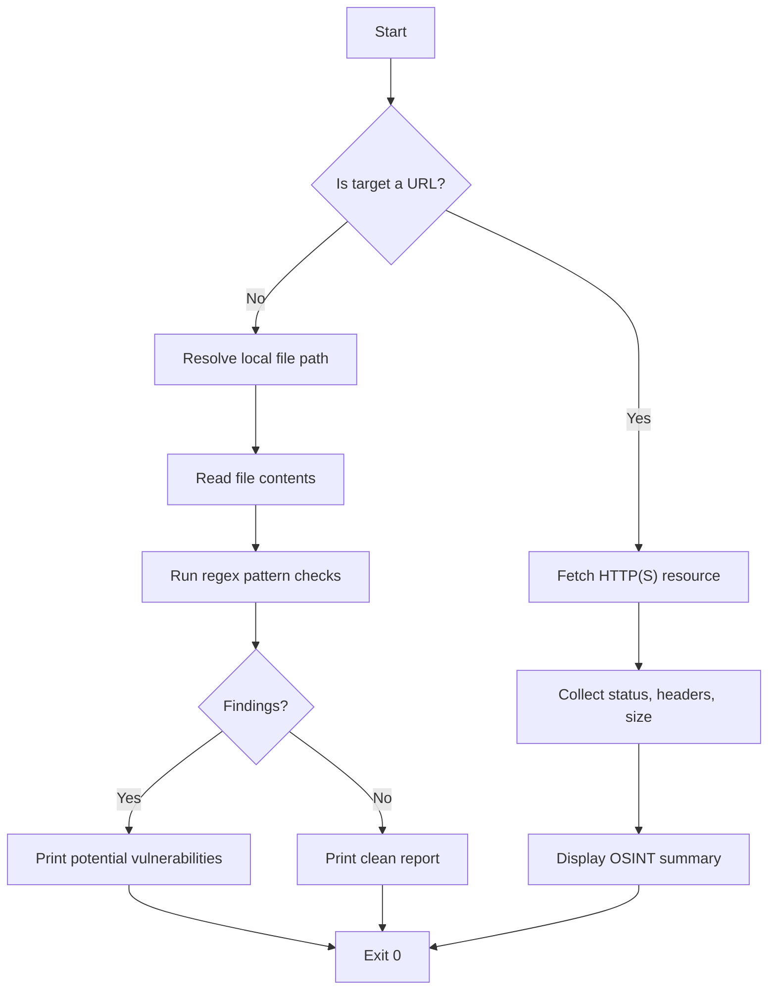

# OSINT‑Vuln‑Scan CLI

**Unified OSINT and static code vulnerability scanner for security‑focused developers**

[](https://opensource.org/licenses/MIT) [](https://nodejs.org/) [](#) [](#) [](#)

---

## 📦 Installation & Quick Start

```bash
# Clone the repository
git clone https://github.com/your‑username/osint-vuln-scan-cli.git
cd osint-vuln-scan-cli

# Run the CLI directly with Node
node src/index.js <target>
```

Replace `<target>` with either a URL (e.g., `https://example.com`) or a path to a local source file.

---

## 🚀 Usage Examples

### OSINT on a public website

```bash
node src/index.js https://example.com
```

**Output**

```
OSINT Summary:
Status: 200
Content length: 12543
```

### Static code vulnerability scan

```bash
node src/index.js ./src/index.js
```

**Output**

```
Potential vulnerabilities:
- Use of eval() can lead to code injection
```

---

## 🖥️ Visual Terminal Showcase

```
$ node src/index.js ./sample/vulnerable.js
Potential vulnerabilities:
- Use of eval() can lead to code injection
- Unvalidated exec() may spawn arbitrary commands
```

---

## 🏗️ Architecture Flowchart



---

## 🧪 Test Results

## 🧪 Real-World Test Telemetry

> [!NOTE]
> Verified automatically using Node.js native test runner (`node:test` & `node:assert/strict`).

```bash
▶ node --test
TAP version 13
# Subtest: detect eval usage in JavaScript file
ok 1 - detect eval usage in JavaScript file
  ---
  duration_ms: 39.237537
  ...
# Subtest: handle non‑existent file gracefully
ok 2 - handle non‑existent file gracefully
  ---
  duration_ms: 34.401433
  ...
1..2
# tests 2
# suites 0
# pass 2
# fail 0
# cancelled 0
# skipped 0
# todo 0
# duration_ms 121.445388
```

---

## 📜 License

MIT License (c) 2026 Suman Mehta. See the [LICENSE](LICENSE) file for details.